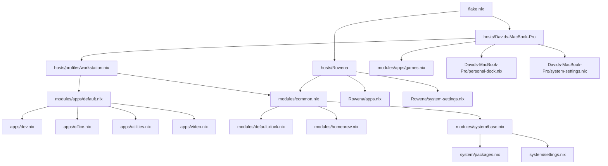

# davidsaulrodriguez/nix-config

Declarative macOS configuration for my Apple Silicon Macs, built with **[Determinate Nix](https://determinate.systems/nix-installer/)**, **[nix-darwin](https://github.com/nix-darwin/nix-darwin)**, and **[nix-homebrew](https://github.com/zhaofengli/nix-homebrew)**.

This repository manages system defaults, PAM authentication (Touch ID & Apple Watch `sudo`), Zsh, CLI packages, GUI applications (across Nix, Homebrew Casks, and the Mac App Store), Dock layouts, and background `launchd` services from a single flake.

---

## Core Stack

| Layer | Tool / Input | Role |
| :--- | :--- | :--- |
| **Nix Installer & Daemon** | Determinate Nix | Manages the Nix installation, daemon, and `/etc/nix/nix.conf` (`nix.enable = false` in `nix-darwin`) |
| **Package Set** | `nixpkgs` (`nixpkgs-unstable`) | Rolling Nix packages (`environment.systemPackages`) |
| **macOS System Management** | `nix-darwin` (`master`) | macOS `defaults`, `launchd` daemons, PAM (`sudo_local`), power, networking, and Zsh |
| **Homebrew Lifecycle** | `nix-homebrew` | Bootstraps and manages `/opt/homebrew` declaratively with `autoMigrate = true` and mutable taps |
| **App Store Automation** | `mas` | Installs and verifies Mac App Store apps declared in `homebrew.masApps` |

---

## Configured Hosts

### 1. `Davids-MacBook-Pro` — Primary Workstation
* **Hardware:** MacBook Pro (Apple M2 Max, 96 GB RAM, 2 TB Storage, `aarch64-darwin`)
* **Profile:** [`hosts/profiles/workstation.nix`](hosts/profiles/workstation.nix) + [`modules/apps/games.nix`](modules/apps/games.nix)
* **Highlights:**
  * **Development:** JetBrains IDEs (IntelliJ IDEA, PhpStorm, WebStorm), Android Studio + dynamic Android SDK `PATH` (`platform-tools`, `emulator`, `cmdline-tools`, and latest `build-tools/*`), Nix-managed OpenJDK 25 linked into `/Library/Java/JavaVirtualMachines/openjdk-25.jdk` for `/usr/libexec/java_home`, Laravel Herd, `fnm` (Fast Node Manager with `--use-on-cd`), and `direnv` + `nix-direnv`.
  * **Creative & Productivity:** Final Cut Pro, Motion, Compressor, `ffmpeg`, `yt-dlp`, Google Chrome, Pages, Numbers, Keynote, Magnet, LinkMyMac, Headrest, Apple Developer, Transporter, TestFlight, Swift Playgrounds, and Tailscale.
  * **Gaming:** Luanti and GRID Legends.
  * **Desktop & Shell:** Custom 48px Dock with spacers and Chrome Web Apps ([`personal-dock.nix`](hosts/Davids-MacBook-Pro/personal-dock.nix)), screenshots saved to `~/Pictures/screenshots`, and Zsh with autosuggestions, completion, fast syntax highlighting, and 100k history.

### 2. `Rowena` — Always-On Media & Home Server
* **Hardware:** Apple Silicon Mac (Apple M4, 16 GB RAM, 256 GB Storage, `aarch64-darwin`)
* **Profile:** Server-lean — imports [`modules/common.nix`](modules/common.nix) directly without workstation desktop bloat (no Chrome, iWork, or dev IDEs)
* **Highlights:**
  * **Power & Reliability ([`hosts/Rowena/system-settings.nix`](hosts/Rowena/system-settings.nix)):** Never sleeps (`computer`, `display`, and `harddisk` set to `"never"`), power button sleep disabled, and automatic reboot enabled after system freezes (`restartAfterFreeze`) or power loss (`restartAfterPowerFailure`).
  * **Services & Apps ([`hosts/Rowena/apps.nix`](hosts/Rowena/apps.nix)):**
    * **Jellyfin** (`127.0.0.1:8096`) and **Transmission** (`127.0.0.1:9091`) installed via Homebrew Casks.
    * **Tailscale** installed via Mac App Store (`masApps`).
    * **Caddy Reverse Proxy:** Native `launchd.daemons.caddy` service built from an inline Nix `Caddyfile`, serving `jellyfin.enyutech.com` and `transmission.enyutech.com` over HTTPS (`tls internal`, with `HOME=/var/root` for persistent local PKI certificates) and logging to `/var/log/caddy.{log,err}`.

---

## Repository Structure

```text
nix-config/
├── flake.nix                         # Flake inputs and darwinConfigurations outputs
├── flake.lock                        # Locked revisions for nixpkgs, nix-darwin, and nix-homebrew
├── hosts/
│   ├── profiles/
│   │   └── workstation.nix           # Shared role profile for full desktop/dev Macs
│   ├── Davids-MacBook-Pro/
│   │   ├── default.nix               # Host entrypoint, allowUnfree, nix-homebrew user/migration
│   │   ├── personal-dock.nix         # Custom Dock layout, spacers, and app paths
│   │   └── system-settings.nix       # Hostname, primaryUser, laptop power, screenshot & Zsh overrides
│   └── Rowena/
│       ├── default.nix               # Host entrypoint, hostname, primaryUser, nix-homebrew user
│       ├── apps.nix                  # Caddy reverse-proxy daemon + Jellyfin, Transmission & Tailscale
│       └── system-settings.nix       # Always-on server power policies & Zsh overrides
└── modules/
    ├── common.nix                    # Universal base imported by every host (platform, dock, brew, system)
    ├── default-dock.nix              # Fallback macOS Dock layout (via lib.mkDefault)
    ├── homebrew.nix                  # nix-homebrew + brew bundle policies + automatic `mas` CLI
    ├── apps/
    │   ├── default.nix               # Aggregates workstation app modules (dev, office, utilities, video)
    │   ├── dev.nix                   # IDEs, OpenJDK 25 symlink, Android SDK, Herd, fnm, direnv
    │   ├── games.nix                 # Optional gaming packages & App Store titles
    │   ├── office.nix                # Google Chrome & iWork suite (Pages, Numbers, Keynote)
    │   ├── utilities.nix             # Desktop utilities (Tailscale, Magnet)
    │   └── video.nix                 # Video production suite (Final Cut Pro, Motion, Compressor, ffmpeg, yt-dlp)
    └── system/
        ├── base.nix                  # Aggregates core system packages and settings
        ├── packages.nix              # Universal CLI tools (vim, git, gnupg, pinentry_mac)
        └── settings.nix              # stateVersion, Determinate Nix handoff, PAM Touch ID/Watch sudo, defaults
```

### Module Dependency Flow



---

## Design Decisions: Where Things Go & Why

1. **Universal Base (`modules/common.nix` & `modules/system/`)**
   * Imported by **every** Mac, whether laptop or headless server.
   * Uses `lib.mkDefault` extensively (in `settings.nix`, `homebrew.nix`, and `default-dock.nix`) so individual hosts can cleanly override Dock layouts, power behavior, or Zsh flags without `lib.mkForce`.
   * Sets `nix.enable = false` in [`modules/system/settings.nix`](modules/system/settings.nix) because **Determinate Nix** owns the Nix daemon and `/etc/nix/nix.conf`.
   * Enables `security.pam.services.sudo_local` with both `touchIdAuth` and `watchIdAuth` so `sudo` prompts work seamlessly via Touch ID or Apple Watch across macOS upgrades.

2. **Role Profiles (`hosts/profiles/`) vs. Feature Modules (`modules/apps/`)**
   * Feature modules under `modules/apps/` group **everything** needed for a domain in one file—Nix packages, Homebrew casks, App Store IDs, Zsh init snippets, and activation scripts—so enabling or removing a workflow doesn't require hunting across multiple directories.
   * `hosts/profiles/workstation.nix` bundles desktop/creative/developer modules for personal workstations, keeping server hosts like `Rowena` completely lean.

3. **Package Source Strategy (Nix vs. Homebrew vs. Mac App Store)**
   * **Nix (`environment.systemPackages`):** Preferred for CLI tools (`git`, `vim`, `gnupg`, `ffmpeg`, `yt-dlp`, `caddy`, `fnm`, `direnv`) and reproducible desktop/runtime packages that work cleanly from `/nix/store` (JetBrains IDEs, Chrome, `openjdk25`).
   * **Homebrew Casks (`homebrew.casks`):** Used for macOS apps that self-manage system integrations, SDKs, or helper daemons best from `/Applications` (`android-studio`, `herd`, `jellyfin`, `transmission`).
   * **Mac App Store (`homebrew.masApps`):** Used for Apple first-party apps (Final Cut Pro, Motion, Compressor, iWork, Developer, TestFlight, Transporter) and App Store-distributed utilities (Tailscale, Magnet, LinkMyMac).

4. **`nix-homebrew` & `onActivation` Behavior ([`modules/homebrew.nix`](modules/homebrew.nix))**
   * `cleanup = "uninstall"` keeps `/opt/homebrew` strictly declarative by removing undeclared formulae and casks on rebuild (change to `"zap"` if you also want app support files purged).
   * `autoUpdate = false` is intentional when using `nix-homebrew`: Homebrew's version is pinned in `flake.lock`, formula/cask metadata updates automatically via Homebrew's JSON API, and disabling `brew`'s internal `auto-update` re-exec prevents it from resetting `HOMEBREW_PATH` and hiding the Nix-provided `mas` binary during `brew bundle`.

5. **macOS Java Discovery ([`modules/apps/dev.nix`](modules/apps/dev.nix))**
   * Nix's `pkgs.openjdk25` builds a full Zulu `.jdk` bundle inside `/nix/store`, but macOS tools (`/usr/libexec/java_home -V` and Android Studio) scan `/Library/Java/JavaVirtualMachines/*.jdk/Contents/Info.plist`. A `postActivation` script symlinks `${pkgs.openjdk25}/Library/Java/JavaVirtualMachines/zulu-25.jdk` to `/Library/Java/JavaVirtualMachines/openjdk-25.jdk` on every rebuild.

---

## Prerequisites & Setup on a New Mac

1. **Install Determinate Nix:**
   ```zsh
   curl --proto '=https' --tlsv1.2 -sSf -L https://install.determinate.systems/nix | sh -s -- install
   ```
2. **Sign in to the Mac App Store:** Open `App Store.app` and sign in with your Apple Account so `mas` can install declared `masApps`.
3. **Grant App Management Permission:** In **System Settings → Privacy & Security → App Management**, enable your terminal emulator (e.g., Terminal or iTerm2) so `darwin-rebuild` is allowed to update app bundles inside `/Applications/Nix Apps`.
4. **Clone & Bootstrap:**
   ```zsh
   git clone https://github.com/davidsaulrodriguez/nix-config.git ~/nix-config
   sudo nix run nix-darwin/master#darwin-rebuild -- switch --flake ~/nix-config#<HostName>
   ```

---

## Day-to-Day Commands

### Apply configuration changes
```zsh
# On Davids-MacBook-Pro
sudo darwin-rebuild switch --flake ~/nix-config#Davids-MacBook-Pro

# On Rowena
sudo darwin-rebuild switch --flake ~/nix-config#Rowena
```

### Dry-build / validate without switching
```zsh
darwin-rebuild build --flake ~/nix-config#Davids-MacBook-Pro
darwin-rebuild build --flake ~/nix-config#Rowena
```

### Update flake inputs (Nixpkgs, nix-darwin, nix-homebrew)
```zsh
cd ~/nix-config
nix flake update
sudo darwin-rebuild switch --flake ~/nix-config#$(scutil --get LocalHostName)
```

---

## Adding a New Host

1. Create `hosts/<NewHostName>/default.nix`:
   * Import `../profiles/workstation.nix` (for a desktop/laptop) or `../../modules/common.nix` (for a lean server).
   * Set `networking.hostName = "<NewHostName>";`, `system.primaryUser = "<username>";`, `nixpkgs.config.allowUnfree = true;`, and `nix-homebrew = { user = "<username>"; autoMigrate = true; };`.
2. Add any host-specific overrides (e.g., `system-settings.nix`, `apps.nix`, or a custom Dock file) and import them from `hosts/<NewHostName>/default.nix`.
3. Register `<NewHostName>` under `outputs.darwinConfigurations` in [`flake.nix`](flake.nix):
   ```nix
   "<NewHostName>" = nix-darwin.lib.darwinSystem {
     specialArgs = { inherit self; };
     modules = [
       nix-homebrew.darwinModules.nix-homebrew
       ./hosts/<NewHostName>/default.nix
     ];
   };
   ```
4. Build and activate with `sudo darwin-rebuild switch --flake ~/nix-config#<NewHostName>`.
